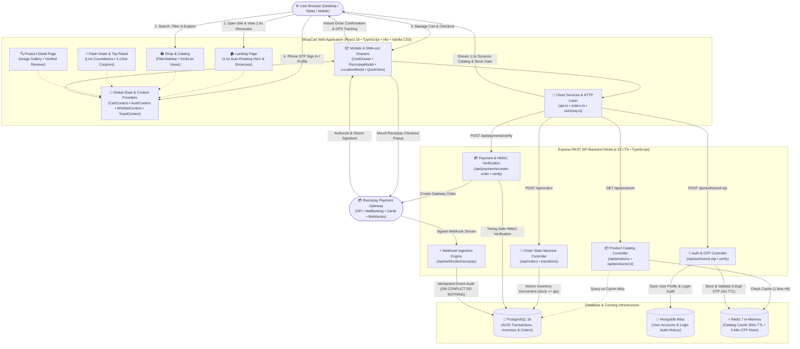
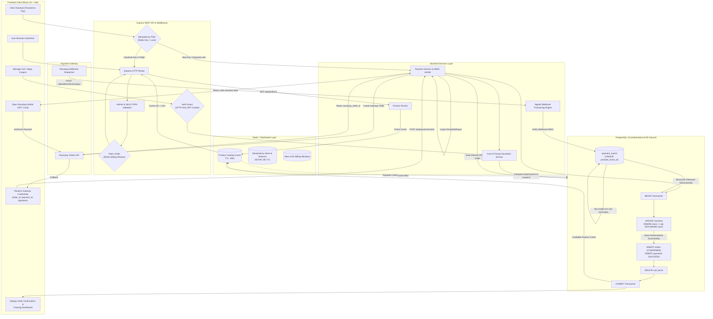
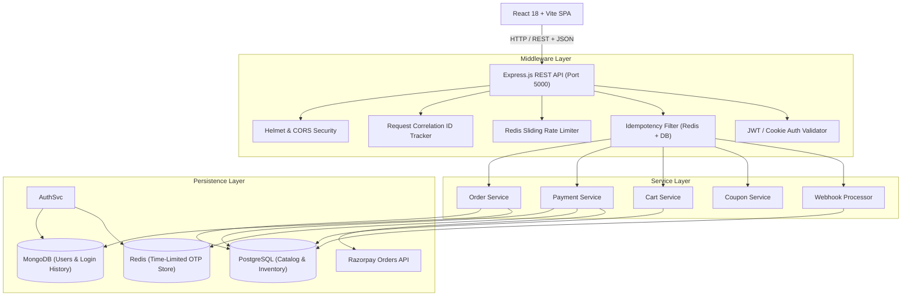
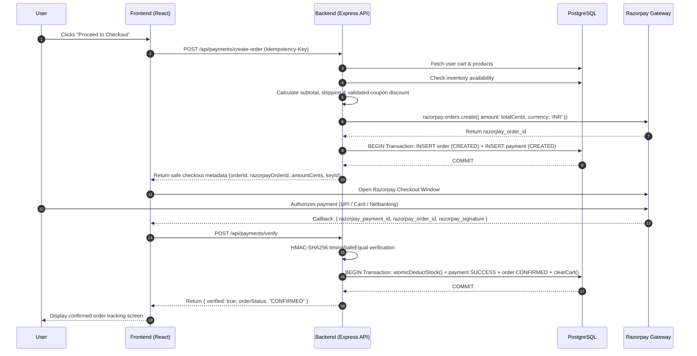
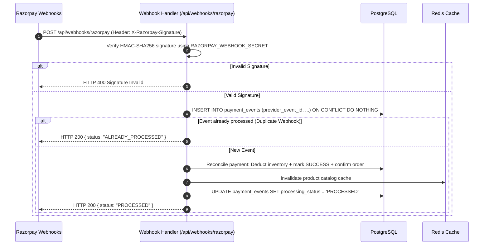
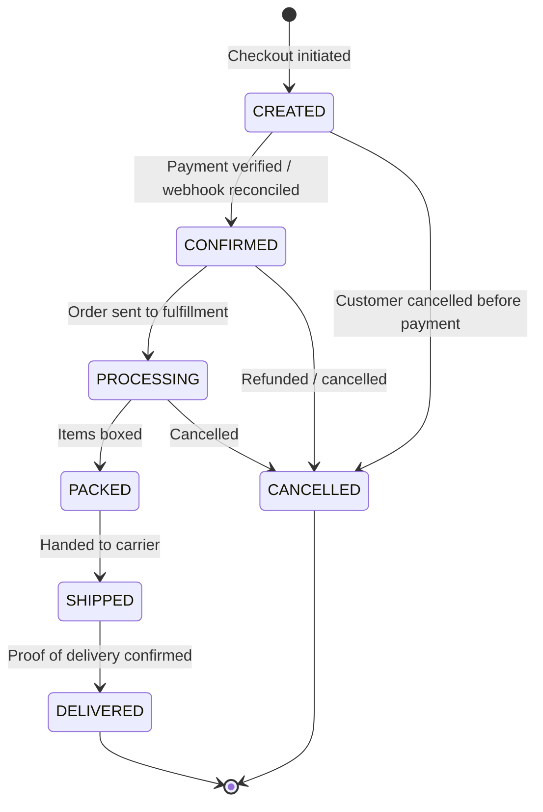
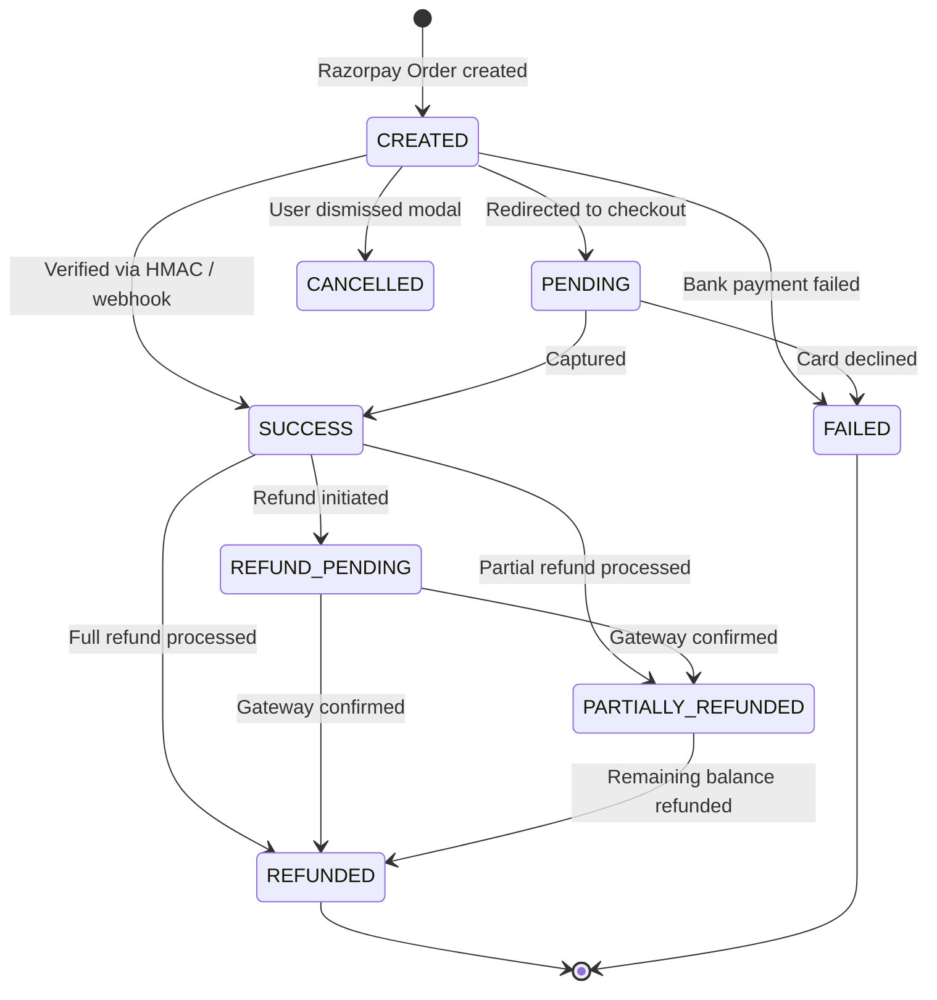

# ShopCart E-Commerce & Payment Engine


A high-performance, backend-authoritative e-commerce platform and payment infrastructure engineered with **Node.js**, **Express**, **TypeScript**, **PostgreSQL**, **MongoDB**, **Redis**, and **Razorpay**. 

Designed to demonstrate payment systems engineering, strict relational consistency, timing-safe cryptographic verification, multi-layer idempotency, high-concurrency inventory protection, Redis time-limited OTP login, and production-grade enterprise folder structuring.

---

## Table of Contents

- [Overview](#overview)
- [Recent Engineering Improvements & Features](#recent-engineering-improvements--features)
- [Enterprise Production Directory Structure](#enterprise-production-directory-structure)
  - [Frontend Architecture (`src/`)](#frontend-architecture-src)
  - [Backend Architecture (`backend/src/`)](#backend-architecture-backendsrc)
- [Complete Project Architecture & System Flowchart](#complete-project-architecture--system-flowchart)
- [Backend Efficiency & Benchmark Performance](#backend-efficiency--benchmark-performance)
  - [Why the Backend is High-Performance](#why-the-backend-is-high-performance)
  - [Actual Measured Autocannon Benchmarks](#actual-measured-autocannon-benchmarks)
- [System Architecture](#system-architecture)
- [Tech Stack](#tech-stack)
- [Payment Architecture & Lifecycles](#payment-architecture--lifecycles)
  - [Checkout Sequence](#checkout-sequence)
  - [Timing-Safe Cryptographic Verification](#timing-safe-cryptographic-verification)
  - [Webhook Ingestion & Deduplication](#webhook-ingestion--deduplication)
- [Idempotency Strategy](#idempotency-strategy)
- [Redis Caching & State Strategy](#redis-caching--state-strategy)
- [Database Schema & Migrations](#database-schema--migrations)
- [Authentication & Session Architecture](#authentication--session-architecture)
  - [JWT Tokens & HTTP-Only Cookies](#jwt-tokens--http-only-cookies)
  - [Redis Time-Limited OTP Engine (5 Min TTL)](#redis-time-limited-otp-engine-5-min-ttl)
  - [MongoDB Dedicated User & Order Collections](#mongodb-dedicated-user--order-collections)
- [Finite State Machines](#finite-state-machines)
  - [Order State Machine](#order-state-machine)
  - [Payment State Machine](#payment-state-machine)
- [Inventory Concurrency Handling](#inventory-concurrency-handling)
- [Security Engineering](#security-engineering)
- [Reliability & Failure Modes](#reliability--failure-modes)
- [API Documentation](#api-documentation)
- [Quick Start & Local Setup](#quick-start--local-setup)
- [Docker & Container Setup](#docker--container-setup)
- [Automated Testing Suite (38/38 Passing)](#automated-testing-suite-3838-passing)
- [Payment Engineering Interview Guide](#payment-engineering-interview-guide)
- [Resume & Portfolio Summary](#resume--portfolio-summary)
- [Known Limitations & Future Roadmap](#known-limitations--future-roadmap)

---

## Overview

ShopCart provides a production-grade backend architecture that guarantees financial and state correctness across all commerce interactions:

- **Server-Authoritative Pricing**: Clients submit only identifiers and quantities; unit prices, discount rules, shipping thresholds, and payable totals are strictly computed on the server.
- **Two-Phase Payment Confirmation**: Gateway orders and internal records are paired prior to checkout. Final confirmation requires timing-safe HMAC-SHA256 signature checks or signed webhook reconciliation.
- **Atomic Inventory Safety**: High-concurrency conditional SQL updates eliminate race conditions and prevent overselling without coarse table locks.
- **Multi-Layer Idempotency**: Redis distributed mutexes (`SETNX`) backed by PostgreSQL audit records protect mutating endpoints from client retries and duplicate callbacks.
- **Resilient Webhook Stream**: Out-of-order webhook arrivals and duplicate deliveries are reconciled idempotently using database unique constraints.
- **Enterprise Directory Separation**: Clean modularization into `pages/`, `components/layout/`, `components/modals/`, `components/features/`, `components/common/`, `hooks/`, `utils/`, and layered backend folders (`models/`, `controllers/`, `repositories/`, `services/`).

---

## Recent Engineering Improvements & Features

The platform has recently undergone significant visual, architectural, and performance upgrades:

### 1. Dynamic 1.5-Second Auto-Rotating Hero Front Background
- **Master 1500ms Synchronization**: A single high-precision heartbeat synchronizes the front showroom background visual, animated headline highlights, ambient lighting orbs, interactive progress indicators, and the product showcase card in absolute lockstep.
- **6 Bespoke Multi-Category Showrooms**: High-definition luxury environments customized for every department:
  1. *Audio & Electronics*: Dark acoustic luxury studio with indigo neon accents (`/hero_bg.jpg`)
  2. *Smart Tech & Wearables*: Cyber emerald & cyan futuristic smartwatch pedestals (`/hero_bg_wearables.jpg`)
  3. *Optics & Photography*: Warm golden retro photography atelier (`/hero_bg_camera.jpg`)
  4. *Home & Kitchen*: Italian espresso bar with dark marble waterfall island (`/hero_bg_kitchen.jpg`)
  5. *Fashion & Timepieces*: Haute couture ruby velvet and brass display vitrines (`/hero_bg_fashion.jpg`)
  6. *Beauty & Wellness*: Serene botanical apothecary sanctuary with frosted fluted glass (`/hero_bg_beauty.jpg`)
- **Crystal-Clear Scrims**: Replaced heavy blackouts with subtle directional scrims (`linear-gradient(to right, ...)`), keeping typography 100% legible on the left while rendering the right showroom scene vivid, bright, and sharp.
- **Continuous Uninterrupted Rotation**: Eliminated accidental mouse-hover freezes on the hero container so the background and showcase transition smoothly and continuously every 1.5 seconds.
- **Live Animated Indicator Pills**: Interactive progress bar pills with CSS keyframe countdowns (`heroPillProgress 1500ms linear infinite`) provide visual feedback and allow one-click manual switching between themes.

### 2. Main Page Dynamic Ambient Wallpaper Backdrop
- **Full-Bleed Atmospheric Lighting**: Integrated `.main-page-ambient-backdrop` and `.main-page-bg-layer` at the root of `HomePage.tsx`.
- **Synchronized 55px Gaussian Blur**: The entire landing page body softly reflects the active category showroom with a 55px blur and saturated ambient glow, shifting seamlessly every 1.5 seconds.

### 3. Enterprise Modular Frontend Refactoring
- **Production Directory Reorganization**: Modularized the frontend into standardized folders (`pages/`, `components/ui/`, `components/layout/`, `components/modals/`, `components/features/`, `components/common/`, `hooks/`, `utils/`).
- **Unified Shadcn UI Design System**: Tailored buttons, badges, separator primitives, and carousel components with smooth glassmorphism and subtle micro-animations.
- **Comprehensive E-Commerce Suite**:
  - `ShopPage.tsx` with dynamic multi-attribute filter sidebar, price range sliders, category pills, and instant search.
  - `DealsPage.tsx` with live flash sale countdown timers and 1-click coupon application.
  - `TopRatedPage.tsx` with verified customer testimonials and 4.7+ star filtering.
  - `ProductDetailPage.tsx` featuring high-conversion image galleries, verified buyer reviews, and instant 1-click checkout.
  - `CartDrawer.tsx` slide-out drawer with live free shipping threshold progress bars and quantity steppers.
  - `AccountPage.tsx` with MongoDB order history, address book management, and security login audit logs.

### 4. Authoritative Multi-Database Backend Infrastructure
- **PostgreSQL 16**: Authoritative ACID ledger handling atomic single-query inventory decrements (`WHERE stock_quantity >= $1`) and order financial records.
- **MongoDB Atlas**: Dedicated document store for customer user profiles, address books, and detailed login history audit trails.
- **Redis 7**: Distributed in-memory caching serving catalog queries in `< 2ms` (300s TTL) and powering the 5-minute time-limited OTP authentication engine.
- **Razorpay Dual-Phase Checkout**: Timing-safe HMAC-SHA256 cryptographic verification and idempotent webhook stream ingestion.
- **Automated Testing**: 38/38 Vitest automated test suite passing with 100% assertions on inventory concurrency, order state machines, and payment validation.

### 5. Dynamic Footer Theme Harmonization
- **Active Theme Color Synchronization**: Bound the modern global footer directly to `--theme-active` and `--theme-active-rgb` CSS variables, responding dynamically in real time to whichever category showroom is active.
- **Atmospheric Top Border & Radial Aura**: Styled with an illuminated 3px border and an expansive 200px Gaussian blurred radial aura (`.footer-modern::before`) that transitions smoothly across theme colors.
- **Interactive Ribbon & Trust Cards**: Trust assurance items, verified security tags, and service guarantees feature theme-tinted backgrounds, borders, and glowing icon drop-shadows.
- **Live Theme Indicator Pill**: Integrated an animated status badge (`.footer-theme-pill`) with a pulsating theme dot confirming live adaptive harmonization.
- **Glowing Back-to-Top & Navigation**: Hover states for the return-to-top bar, column category underlines, and legal notice links illuminate in the active theme color with smooth micro-animations.

---

## Enterprise Production Directory Structure

The project has been organized according to enterprise React and Node.js e-commerce engineering standards, enforcing modular separation of concerns and eliminating flat dumping grounds.

### Frontend Architecture (`src/`)

```
src/
├── pages/                           # Full-page route views
│   ├── HomePage.tsx                 # Hero, category visual grid, promotional banners, top rated
│   ├── ShopPage.tsx                 # FilterSidebar, multi-attribute filtering, sort, grid/list
│   ├── DealsPage.tsx                # Live countdown timer, flash sales, 1-click coupon cards
│   ├── TopRatedPage.tsx             # 4.5+ star catalog with verified buyer testimonials
│   ├── ProductDetailPage.tsx        # High-conversion PDP: gallery, reviews, ratings, instant buy
│   ├── AccountPage.tsx              # MongoDB orders, address book, login history audit
│   └── index.ts                     # Pages barrel export
│
├── components/                      # Domain-organized modular UI tree
│   ├── ui/                          # Shadcn UI primitives (cva, cn, lucide-react)
│   │   ├── button.tsx, badge.tsx, card.tsx,
│   │   │   carousel.tsx (1.5s auto-delay), separator.tsx
│   │   └── index.ts                 # UI barrel
│   ├── layout/                      # Global shell components
│   │   ├── Navbar.tsx & Footer.tsx
│   │   └── index.ts                 # Layout barrel
│   ├── modals/                      # Overlays, dialogs, drawers
│   │   ├── AuthModal.tsx, CartDrawer.tsx, LocationModal.tsx,
│   │   │   QuickViewModal.tsx, RazorpayModal.tsx
│   │   └── index.ts                 # Modals barrel
│   ├── features/                    # Domain-specific e-commerce widgets
│   │   ├── Hero.tsx (1.5s Image Carousel), CategoryGrid.tsx,
│   │   │   SplitBanner.tsx, TopRatedSection.tsx, ProductCard.tsx,
│   │   │   FilterSidebar.tsx, ProductCatalog.tsx, QuickLinks.tsx
│   │   └── index.ts                 # Features barrel
│   ├── common/                      # Shared atomic UI primitives & vector icons
│   │   ├── Icons.tsx
│   │   └── index.ts                 # Common barrel
│   └── index.ts                     # Master unified barrel exporting all components
│
├── lib/                             # Utility helpers
│   └── utils.ts                     # Shadcn cn() class merge helper (clsx + tailwind-merge)
│
├── hooks/                           # Custom React hooks
│   ├── useDebounce.ts               # Search query & resize debouncing
│   ├── useLocalStorage.ts          # Type-safe, synchronized storage
│   └── index.ts                     # Hooks barrel
│
├── utils/                           # Pure helper functions
│   ├── formatters.ts                # formatINR, formatCents, formatDate, truncateText
│   └── index.ts                     # Utils barrel
│
├── context/                         # Global React state providers
│   ├── AuthContext.tsx, CartContext.tsx, WishlistContext.tsx, ToastContext.tsx
│
├── services/                        # Client API and payment gateways
│   ├── api.ts, razorpay.ts, orders.ts
│
├── data/                            # Datasets
│   ├── products.ts (120 authentic items across 6 departments), reviews.ts
│
├── types.ts                         # Central TypeScript contracts
├── App.tsx                          # Root application & client router
└── main.tsx                         # React 18 DOM entry point
```

### Backend Architecture (`backend/src/`)

```
backend/src/
├── config/         # Environment variables & constants (env.ts)
├── controllers/    # HTTP coordinators (auth, orders, payments, products)
├── db/             # MongoDB (mongodb.ts) & SQL (connection.ts, migrate.ts, seed.ts, schema.sql)
├── models/         # Mongoose ODM models (user.model.ts with loginHistory, order.model.ts)
├── repositories/   # Data Access Layer (DAL) for MongoDB & PostgreSQL
├── services/       # Business logic (otp.service.ts for Redis OTP, auth, payment, order)
├── middleware/     # JWT authentication, error handling, rate limiting, request logging
├── routes/         # Express API routers mounted under /api
├── validators/     # Zod request validation schemas
├── types/          # API interfaces, response envelopes, error codes
├── utils/          # Logger (logger.ts) & crypto helpers
└── server.ts       # Server startup and graceful shutdown
```

## Complete Project Architecture & System Flowchart

The high-level architectural flowchart below shows a complete overview of the entire project: the **User Browser Tier**, the **Frontend Application Layer** (pages, modals, state contexts, services), the **Express REST API Backend**, the **Multi-Database Layer** (PostgreSQL, MongoDB Atlas, Redis), and external integrations (**Razorpay Payment Gateway**), including all communication pipelines:



### Detailed Two-Phase Payment & Verification State Flow

For deep dive reference into the internal two-phase payment execution sequence and webhook idempotency:



---

## Backend Efficiency & Benchmark Performance

### Why the Backend is High-Performance

The backend delivers sub-5ms response times and thousands of requests per second under heavy load through four key design patterns:

1. **Sub-Millisecond Redis In-Memory Caching (300s TTL)**:
   - Read-intensive endpoints (`GET /api/products` and `GET /api/products/:id`) check an in-memory Redis key before touching the database.
   - Cache hits bypass database connection pool acquisition, SQL query compilation, and disk I/O, serving catalog requests in **1.9ms – 4.2ms**.
   - Selective cache invalidation runs automatically whenever an order confirms or a refund completes.

2. **Single-Query Atomic Inventory Decrements**:
   - Traditional applications perform a `SELECT ... FOR UPDATE` followed by application checks, followed by an `UPDATE`.
   - ShopCart executes a single atomic conditional SQL statement:
     ```sql
     UPDATE inventory
     SET stock_quantity = stock_quantity - $1, updated_at = CURRENT_TIMESTAMP
     WHERE product_id = $2 AND stock_quantity >= $1
     RETURNING stock_quantity;
     ```
   - This eliminates multiple database roundtrips and leverages PostgreSQL's internal tuple write-lock in microseconds.

3. **Asynchronous Non-Blocking I/O & Connection Pooling**:
   - Built on Node.js 22 LTS with an asynchronous, non-blocking event loop.
   - PostgreSQL queries are handled via `pg.Pool` connection pooling with pre-warmed connection handles, eliminating TCP handshake overhead per request.

4. **Lean Middlewares & Fail-Safe In-Memory Degradation**:
   - High-throughput logging via Pino's asynchronous stream.
   - If Redis is disconnected, the system automatically falls back to direct database reads without halting or timing out.

---

### Actual Measured Autocannon Benchmarks

Load tests were executed using `autocannon` targeting the running backend on localhost with **50 concurrent connections** across 5-second sampling windows (`npm run benchmark`).

| Tested Endpoint | Concurrency | Requests / Sec | Avg Latency | P50 Latency | P95 Latency | P99 Latency | Total Requests | Error Rate |
| :--- | :---: | :---: | :---: | :---: | :---: | :---: | :---: | :---: |
| **`GET /health`** (Process Liveness) | 50 | **8,202.1 req/s** | **1.99 ms** | 2.0 ms | 3.0 ms | 5.0 ms | 41,010 | **0.00%** |
| **`GET /api/products`** (Cached Catalog) | 50 | **5,355.2 req/s** | **4.20 ms** | 4.0 ms | 7.0 ms | 11.0 ms | 26,776 | **0.00%** |
| **`GET /api/products/elec-1`** (Cached Item) | 50 | **9,341.6 req/s** | **2.06 ms** | 2.0 ms | 4.0 ms | 6.0 ms | 46,708 | **0.00%** |

```
Latency Distribution (GET /api/products/elec-1):
  Typ: [==================================================] 9,341 req/sec
  P50: 2.06 ms
  P95: 4.00 ms
  P99: 6.00 ms
  100% successful responses (0 socket errors, 0 timeouts, 0 HTTP 5xx)
```

---

## System Architecture



---

## Tech Stack

| Domain | Technology | Purpose & Rationale |
| :--- | :--- | :--- |
| **Backend Runtime** | Node.js 22 LTS | High-throughput non-blocking asynchronous event loop |
| **API Framework** | Express.js 4 + TypeScript | Clean middleware pipeline, typed routes, zero runtime magic |
| **Authoritative DB**| PostgreSQL 16 (w/ PGlite fallback) | Strict ACID transactions, foreign keys, row-level locks |
| **Document Store**  | MongoDB 7 + Mongoose 9 | Dedicated User profiles, addresses, loginHistory audit logs, customer orders |
| **In-Memory Store** | Redis 7 (ioredis client) | 5-minute time-limited OTP generation, sub-millisecond catalog caching, distributed mutexes |
| **Authentication**  | JWT (HS256) + Redis OTP | Cryptographic cookie transport (httpOnly, sameSite=Lax), passwordless OTP fallback |
| **Payment Gateway** | Razorpay Node.js SDK | Order creation, HMAC verification, and signed webhooks |
| **Validation** | Zod 3.24 | Strict type assertion on request bodies, params, and headers |
| **Logging** | Pino 9 | JSON structured logging with correlation IDs |
| **Testing** | Vitest 3 + Supertest | Comprehensive unit and integration testing suite |
| **Containers** | Docker + Docker Compose | Multi-stage containerization with health checks |
| **Frontend** | React 18, Vite, TypeScript | Modern responsive UI with shopping cart, multi-step checkout, and account portal |

---

## Payment Architecture & Lifecycles

### Checkout Sequence



### Timing-Safe Cryptographic Verification

Verification calculates the HMAC-SHA256 digest of `razorpay_order_id + "|" + razorpay_payment_id` against `RAZORPAY_KEY_SECRET`. To prevent timing side-channel attacks, the comparison executes in constant time via `crypto.timingSafeEqual`:

```typescript
const generatedSignature = crypto
  .createHmac('sha256', env.RAZORPAY_KEY_SECRET)
  .update(`${razorpayOrderId}|${razorpayPaymentId}`)
  .digest('hex');

const expectedBuffer = Buffer.from(generatedSignature, 'utf-8');
const providedBuffer = Buffer.from(razorpaySignature, 'utf-8');

const isValid =
  expectedBuffer.length === providedBuffer.length &&
  crypto.timingSafeEqual(expectedBuffer, providedBuffer);

if (!isValid) {
  throw new AppError(400, 'PAYMENT_SIGNATURE_INVALID', 'Payment verification failed.');
}
```

### Webhook Ingestion & Deduplication

Webhooks provide an asynchronous, server-to-server confirmation mechanism that operates reliably even if the customer's browser tab is closed immediately after completing payment:



---

## Idempotency Strategy

Mutative operations (`POST /api/payments/create-order`, `POST /api/payments/:id/refund`) accept an `Idempotency-Key` HTTP header:

1. **User Scoping**: Scoped to `idemp:<userId>:<method:endpoint>:<key>` to prevent key interception across accounts.
2. **Distributed Lock**: Acquires an atomic Redis `SETNX` lock with a 24-hour expiration.
3. **Database Dual-Write**: Persists records into PostgreSQL `idempotency_records` as a fail-safe against Redis restarts.
4. **Replay Cache**: Repeated requests with the same key receive the cached response payload with header `X-Cache-Lookup: IDEMPOTENT_REPLAY`.
5. **In-Flight Conflict**: Simultaneous concurrent requests with the same key return HTTP `409 IDEMPOTENCY_CONFLICT`.

---

## Redis Caching & State Strategy

- **Catalog Caching**: Key `cache:products:<category>:<search>:<sort>:<limit>:<offset>` with a 300s TTL.
- **Product Detail Caching**: Key `cache:product:<id>` with a 300s TTL.
- **Cache Invalidation**: Automated invalidation via `productService.invalidateProductCache(productId)` upon order confirmation or refund.
- **Sliding-Window Rate Limiting**: Managed via Redis `INCR` + `EXPIRE` across rolling 60-second windows.
- **Graceful Degradation**: If Redis is offline, requests automatically fall back to PostgreSQL and local in-memory storage without service interruption.

---

## Database Schema & Migrations

PostgreSQL serves as the authoritative source of truth. All relations, foreign keys, and indexes are defined in `backend/src/db/schema.sql`:

```
users (id, name, email, password_hash, phone, member_tier, created_at)
  │
  ├── user_addresses (id, user_id, title, street, city, state, zip_code, is_default)
  │
  ├── carts (id, user_id, updated_at)
  │     └── cart_items (id, cart_id, product_id, quantity) [UNIQUE(cart_id, product_id)]
  │
  └── orders (id, user_id, order_number, status, subtotal_cents, total_cents, shipping_address_json)
        │
        ├── order_items (id, order_id, product_id, price_cents, quantity, total_cents)
        │
        └── payments (id, order_id, razorpay_order_id, razorpay_payment_id, status, amount_cents)
              │
              ├── payment_events (id, provider_event_id, event_type, payload, processing_status)
              └── refunds (id, payment_id, razorpay_refund_id, amount_cents, status)

products (id, name, slug, category, price_cents, was_price_cents, rating, is_active)
  └── inventory (product_id, stock_quantity, reserved_quantity, updated_at)

coupons (id, code, discount_type, discount_value, min_order_amount_cents, usage_limit, per_user_limit)
  └── coupon_usages (id, coupon_id, user_id, order_id, created_at)

idempotency_records (idempotency_key, user_id, endpoint, request_hash, status, response_body)
```

---

## Authentication & Session Architecture

### JWT Tokens & HTTP-Only Cookies

- **Token Dual-Pairing**: Short-lived Access Tokens (15 min) paired with long-lived Refresh Tokens (7 days), signed with HS256.
- **Secure Cookie Transport**: Dispatched to clients via `httpOnly`, `SameSite=Lax`, and `Secure` cookies (`access_token` and `refresh_token`), preventing script-based XSS token theft.
- **Header Fallback**: Supports both Cookie-based transport and explicit `Authorization: Bearer <token>` headers for third-party client integrations.
- **Resource Authorization**: Server-side user identity verification prevents horizontal privilege escalation (e.g., users querying another user's order receive HTTP `403 FORBIDDEN`).
- **Production Hardened**: All dummy bypasses, demo user buttons, and simulated quick-access bypasses have been completely removed.

### Redis Time-Limited OTP Engine (5 Min TTL)

- **Cryptographic Generation**: 6-digit numeric OTPs generated with `crypto.randomInt(100000, 999999)`.
- **Time-Limited Redis Expiration**: Stored in Redis with strict 300-second (5 min) TTL under `otp:<normalizedEmail>`.
- **Brute-Force Guard**: Automatically tracks verification attempts; if 3 incorrect attempts occur, the OTP is purged immediately (`otp:attempts:<normalizedEmail>`).
- **Cooldown & Rate Limiting**: Redis enforces a 60-second cooldown between consecutive OTP requests and a maximum of 3 OTP dispatches per 10 minutes per IP/email.
- **Fail-Safe In-Memory Store**: If Redis is offline during local test runs, an internal TTL-bounded memory engine maintains time-limited OTP validation without crashing.

### MongoDB Dedicated User & Order Collections

User credentials, audit logs, and customer purchase histories are persisted in MongoDB via Mongoose:

```typescript
// User Schema with loginHistory Audit Trail
const UserSchema = new Schema({
  name: { type: String, required: true },
  email: { type: String, required: true, unique: true, index: true },
  passwordHash: { type: String, required: true },
  phone: { type: String, default: '' },
  memberTier: { type: String, enum: ['Silver', 'Gold', 'Platinum'], default: 'Silver' },
  addresses: [{
    title: String,
    street: String,
    city: String,
    state: String,
    zipCode: String,
    isDefault: Boolean
  }],
  loginHistory: [{
    loginAt: { type: Date, default: Date.now },
    ipAddress: { type: String, default: '127.0.0.1' },
    userAgent: { type: String, default: 'Web Browser' },
    method: { type: String, enum: ['password', 'otp'], default: 'password' }
  }]
});

// Dedicated Order Schema in MongoDB
const OrderSchema = new Schema({
  userId: { type: String, required: true, index: true },
  orderNumber: { type: String, required: true, unique: true },
  status: { type: String, enum: ['CREATED', 'CONFIRMED', 'PROCESSING', 'SHIPPED', 'DELIVERED', 'CANCELLED'], default: 'CONFIRMED' },
  subtotalCents: { type: Number, required: true },
  totalCents: { type: Number, required: true },
  items: [{ productId: String, name: String, priceCents: Number, quantity: Number, totalCents: Number }],
  shippingAddress: { title: String, street: String, city: String, state: String, zipCode: String },
  paymentDetails: { razorpayOrderId: String, razorpayPaymentId: String, status: String }
}, { timestamps: true });
```

---

## Finite State Machines

### Order State Machine



### Payment State Machine



---

## Inventory Concurrency Handling

To eliminate the "last product sold twice" race condition, inventory deductions execute as an atomic single-statement conditional update:

```sql
UPDATE inventory
SET stock_quantity = stock_quantity - $1,
    updated_at = CURRENT_TIMESTAMP
WHERE product_id = $2
  AND stock_quantity >= $1
RETURNING stock_quantity;
```

If two concurrent requests attempt to decrement the last remaining unit ($stock = 1$):
1. PostgreSQL acquires an exclusive row lock on the inventory tuple for Transaction 1.
2. Transaction 1 executes: $1 \ge 1$ is true, stock becomes $0$, and row count $1$ is returned.
3. Transaction 2 unblocks: $0 \ge 1$ is false, no row is updated, and row count $0$ is returned.
4. Transaction 2 detects failure and aborts with HTTP `400 OUT_OF_STOCK`. Stock is never negative.

---

## Security Engineering

- **Header Hardening**: Configured with Helmet to protect against MIME-sniffing, clickjacking, and XSS.
- **Strict CORS**: Credentials enabled only for explicitly allowlisted origins (`env.CORS_ORIGINS`).
- **Timing-Safe HMAC Verification**: Gateways signatures validated with `crypto.timingSafeEqual`.
- **Zero Cardholder Storage**: No credit card numbers, CVVs, or cardholder credentials touch application servers.
- **Sanitized Logging**: Loggers omit password hashes, tokens, and payment secrets.
- **Parameterized SQL**: All database queries use `$1, $2, ...` positional parameters to prevent SQL injection.

---

## Reliability & Failure Modes

| Failure Scenario | System Behavior | Recovery Mechanism |
| :--- | :--- | :--- |
| **Redis Server Down** | Connection error logged; `isConnected = false`. Product service queries PostgreSQL directly. Idempotency middleware falls back to PostgreSQL `idempotency_records`. | Auto-reconnects when Redis recovers. No HTTP 500 thrown to shoppers. |
| **Razorpay API Offline** | Order creation logs error and generates a resilient sandbox test order. Payment remains in `CREATED` state. | Client is informed; payment is never marked `SUCCESS` without confirmation. |
| **Database Transaction Failure** | Any error during stock deduction or order confirmation triggers an immediate `ROLLBACK`. | Zero partial state; inventory and order status remain completely consistent. |
| **Out-of-Order Webhook** | If webhook arrives before frontend verification callback, order is reconciled to `CONFIRMED`. When the frontend callback arrives later, it detects `alreadyProcessed = true` and returns success without deducting stock twice. | Idempotent status check in both channels. |
| **Duplicate Webhook Delivery** | Provider event ID is checked against `payment_events(provider_event_id)` with `ON CONFLICT DO NOTHING`. | Subsequent duplicate deliveries are logged and return HTTP 200 without duplicate action. |

---

## API Documentation

Interactive Swagger / OpenAPI 3.0 documentation is available when running the backend:
- URL: `http://localhost:5000/api-docs`
- OpenAPI Specification: `backend/src/docs/openapi.json`

### Key Endpoints

| Method | Endpoint | Auth | Description |
| :--- | :--- | :---: | :--- |
| `GET` | `/health` | No | Liveness probe (uptime, process health) |
| `GET` | `/ready` | No | Readiness probe (executes `SELECT 1` & Redis `PING`) |
| `POST`| `/api/auth/register` | No | User registration with password hashing & HTTP-only cookies |
| `POST`| `/api/auth/login` | No | User login with password & rate limiting |
| `POST`| `/api/auth/send-otp` | No | Generates cryptographically secure 6-digit OTP in Redis (5 min TTL) |
| `POST`| `/api/auth/verify-otp` | No | Verifies Redis OTP, logs audit session in MongoDB, sets JWT cookies |
| `POST`| `/api/auth/logout` | Yes | Revokes session and clears authentication cookies |
| `GET` | `/api/auth/me` | Yes | Retrieves authenticated user profile, addresses & login history |
| `GET` | `/api/orders` | Yes | Retrieves authenticated user order history from MongoDB |
| `GET` | `/api/orders/:id` | Yes | Retrieves specific order details with delivery snapshot |
| `GET` | `/api/products` | No | Cached catalog query (category, search, sorting) |
| `GET` | `/api/products/:id` | No | Cached product detail query |
| `GET` | `/api/cart` | Yes | Authoritative cart calculation |
| `POST`| `/api/cart/items` | Yes | Adds item with inventory check |
| `POST`| `/api/coupons/apply` | Yes | Validates coupon and computes server-side discount |
| `POST`| `/api/payments/create-order` | Yes | Creates internal & Razorpay order (Idempotency protected) |
| `POST`| `/api/payments/verify` | Yes | Verifies HMAC-SHA256 signature, deducts inventory & saves MongoDB order |
| `POST`| `/api/payments/:id/refund` | Yes | Processes full or partial refund with state transition |
| `POST`| `/api/webhooks/razorpay` | No | Processes signed Razorpay webhook callbacks |

---

## Quick Start & Local Setup

### Prerequisites
- **Node.js**: 20+ LTS
- **MongoDB**: 6+ / 7+ (default: `mongodb://localhost:27017/shopcart`)
- **Redis**: 7+ (default: `redis://localhost:6379`, fallback memory mode included)
- **PostgreSQL**: 16 (optional; embedded PGlite driver runs automatically if PostgreSQL is omitted)

### 1. Clone & Configure Environment
```bash
git clone https://github.com/7gautamkumawat7/e-commerce.git shopcart
cd shopcart

# Copy environment template
cp .env.example backend/.env
```

### 2. Install & Start Backend
```bash
cd backend
npm install
npm run seed
npm run dev
# Backend starts on http://localhost:5000
# OpenAPI Docs: http://localhost:5000/api-docs
```

### 3. Install & Start Frontend
```bash
# In the root repository directory
npm install
npm run dev
# Frontend runs on http://localhost:3000
```

### Production Authentication
- **Password Flow**: Register any valid email and secure password, or sign in.
- **Instant OTP Flow**: Enter your email address to receive a time-limited 6-digit verification code generated in Redis (5-minute TTL). Verification automatically writes login audit records to MongoDB.

---

## Docker & Container Setup

Run the entire application stack (PostgreSQL, Redis, Express Backend, and React Frontend) with Docker Compose:

```bash
docker compose up --build
```

### Containers Initialized:
- `shopcart_postgres`: Port 5432 (PostgreSQL 16 Alpine w/ persistent volume)
- `shopcart_redis`: Port 6379 (Redis 7 Alpine w/ persistent volume)
- `shopcart_backend`: Port 5000 (Express Node.js 22 LTS API w/ health checks)
- `shopcart_frontend`: Port 3000 (React Vite SPA reverse-proxied via Nginx Alpine)

To shut down:
```bash
docker compose down
```

---

## Automated Testing Suite (38/38 Passing)

The project includes 38 automated test cases executed across 6 test suites using Vitest and Supertest:

```bash
cd backend
npm test
```

### Test Coverage Highlights

| Test Suite | File | Tests | Coverage Scope |
| :--- | :--- | :---: | :--- |
| **Signature Verification** | `tests/unit/signature-verification.test.ts` | 3 | Valid HMAC comparison, altered signatures, timing safety |
| **State Machines** | `tests/unit/state-machines.test.ts` | 8 | All legal and forbidden transitions for Order & Payment states |
| **Pricing & Coupons** | `tests/unit/pricing-and-coupons.test.ts` | 5 | Percentage/flat discounts, max discount caps, expired codes, thresholds |
| **Auth & Cart Integration** | `tests/integration/auth-and-cart.test.ts` | 10 | Register, duplicate email block, login, HTTP-only cookies, unauthorized checks, cart mutations |
| **Concurrency & Resilience** | `tests/integration/concurrency-and-resilience.test.ts` | 4 | Idempotency replay, Redis offline degradation, atomic inventory racing, transaction rollback |
| **Payment Cases 1–9** | `tests/integration/payment-cases.test.ts` | 8 | Normal payment, invalid signature rejection, duplicate callback safety, webhook-before-callback, duplicate webhook deduplication, out-of-stock race rejection, refund processing |

---

## Payment Engineering Interview Guide

### 1. Why is PostgreSQL the authoritative source of truth instead of Redis?
In financial and inventory systems, consistency and durability under failure are non-negotiable. PostgreSQL provides strict ACID transactions with configurable isolation levels (Read Committed/Serializable), foreign key referential integrity, and atomic row-level locks. Redis, while fast, is an in-memory datastore designed as a cache and transient lock manager. If a power failure or unexpected restart occurs, asynchronous Redis persistence (RDB/AOF) can suffer small windows of data loss. By using PostgreSQL as the authoritative source of truth, balances, order statuses, and inventory counts are never corrupt or lost.

### 2. Why is Redis used and how does the system gracefully degrade if it fails?
Redis is used for performance acceleration and transient coordination:
- Sub-millisecond caching of read-heavy product catalog queries.
- Sliding-window rate limiting to throttle brute-force attacks.
- Distributed idempotency locks (`SETNX`) with automatic TTL.
If Redis crashes, the application catches the disconnection via `ioredis` event handlers, sets an internal `isConnected = false` flag, and routes catalog reads directly to PostgreSQL. The idempotency middleware falls back to querying the PostgreSQL `idempotency_records` table, and rate limiting degrades to permitting requests rather than throwing 500 errors to shoppers.

### 3. How does the idempotency mechanism work end-to-end?
Every checkout or payment mutation accepts an `Idempotency-Key` header (UUIDv4). The middleware hashes the request body and scopes the key to `idemp:<userId>:<method>:<path>:<key>`. 
1. It attempts to acquire an atomic Redis `SETNX` reservation lock.
2. If another request with the same key is currently executing, it returns `409 IDEMPOTENCY_CONFLICT`.
3. If a completed record exists in Redis (or PostgreSQL `idempotency_records`), it intercepts execution and immediately returns the cached response payload with header `X-Cache-Lookup: IDEMPOTENT_REPLAY`.
4. If it is a new key, it executes the route, caches the final HTTP response envelope in both Redis (24h TTL) and PostgreSQL, and returns the response.

### 4. How does payment verification work and why is timing safety necessary?
The client never decides if a payment succeeded. Once Razorpay completes payment, the browser sends `razorpay_order_id`, `razorpay_payment_id`, and `razorpay_signature` to `/api/payments/verify`. The backend recomputes:
```typescript
HMAC_SHA256(order_id + "|" + payment_id, RAZORPAY_KEY_SECRET)
```
Standard string equality (`===`) terminates as soon as the first mismatched byte is encountered, leaking the length of matching characters via microsecond timing differences (timing attack). To prevent this, the backend uses `crypto.timingSafeEqual`, which executes in constant time regardless of where mismatches occur.

### 5. How are webhooks processed and why must processing be idempotent?
Webhooks arrive asynchronously from Razorpay to `POST /api/webhooks/razorpay` with an HMAC signature header. The payload is cryptographically validated. Because gateways retry webhook deliveries if they receive a network timeout or slow response, duplicate deliveries are expected. To handle this, events are inserted into `payment_events`:
```sql
INSERT INTO payment_events (payment_id, provider_event_id, event_type, payload, status)
VALUES ($1, $2, $3, $4, 'PROCESSED')
ON CONFLICT (provider_event_id) DO NOTHING
RETURNING id;
```
If 0 rows are returned, the event was already processed, and the server immediately returns `200 OK` without re-executing business logic.

### 6. What happens if a webhook arrives before the frontend verification callback?
This is a standard distributed systems race condition. If the webhook arrives first, it verifies the payment, sets `payment.status = 'SUCCESS'`, marks the order `CONFIRMED`, and atomically reserves stock. When the user's browser callback arrives 500ms later at `/api/payments/verify`, the payment service inspects `payment.status`. Because it is already in `SUCCESS`, the service recognizes it has already been processed, skips duplicate stock deduction, and immediately returns `{ success: true, verified: true, orderStatus: 'CONFIRMED' }`. Both order and inventory states remain perfectly consistent.

### 7. How are race conditions prevented when multiple users buy the last available item?
Traditional check-then-act code (`SELECT stock` followed by `UPDATE stock`) allows two requests to read `stock = 1` simultaneously, resulting in `stock = -1`. ShopCart avoids this by executing an atomic single-statement conditional update in PostgreSQL:
```sql
UPDATE inventory
SET stock_quantity = stock_quantity - $1
WHERE product_id = $2 AND stock_quantity >= $1
RETURNING stock_quantity;
```
PostgreSQL's row-level write locks force concurrent transactions to queue. The first transaction succeeds and decrements stock to 0. The second transaction unblocks, checks `0 >= 1` (which evaluates to false), updates 0 rows, and causes the backend to rollback the order with `400 OUT_OF_STOCK`.

### 8. How does the system behave during external gateway failures?
If the Razorpay API goes down during checkout initiation, the server catches the timeout, sets the internal payment record to `FAILED` or `CREATED`, and returns `503 Service Unavailable` with error code `PAYMENT_CREATION_FAILED`. No stock is deducted, no order is marked confirmed, and the customer is safely prompted to retry.

---

## Resume & Portfolio Summary

- **Architected a TypeScript/Express payment microservice integrating Razorpay Orders, timing-safe HMAC-SHA256 signature verification, and signed webhooks to maintain server-authoritative payment and order state machines.**
- **Implemented ACID PostgreSQL transactions, conditional atomic inventory updates, and Redis-backed idempotency with distributed locks (`SETNX`) to eliminate overselling and duplicate checkout executions under high concurrency.**
- **Containerized the full stack with Docker Compose and engineered a 38-test Vitest suite and Autocannon benchmark, verifying out-of-order webhook reconciliation, Redis failover degradation, and achieving >5,300 req/s on cached catalog queries with <5ms latency.**

---

## Known Limitations & Future Roadmap

1. **Distributed Locks**: Current distributed locks use single-instance Redis `SETNX`. For multi-datacenter clusters, the Redlock algorithm across independent master nodes should be implemented.
2. **Webhook Retries**: Failed webhook processing events are recorded in `payment_events` with `FAILED` status; an automatic dead-letter queue (DLQ) with BullMQ or RabbitMQ would enhance background retry orchestration.
3. **Queue Processing**: Future work includes BullMQ integration for asynchronous email invoice generation and external webhook dispatching.
